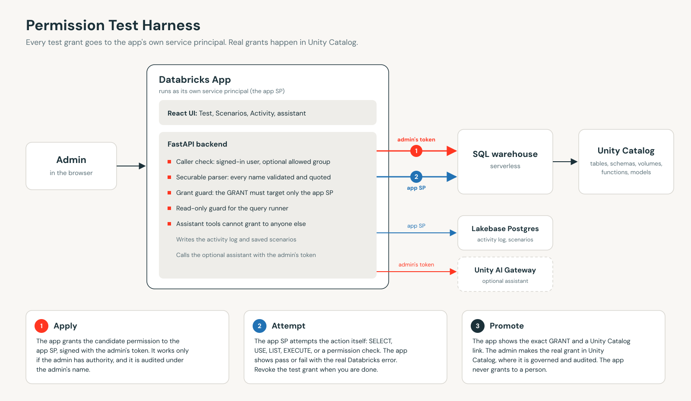
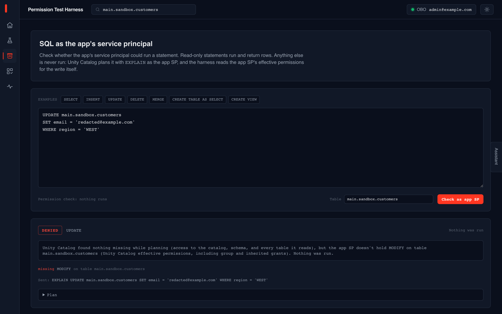
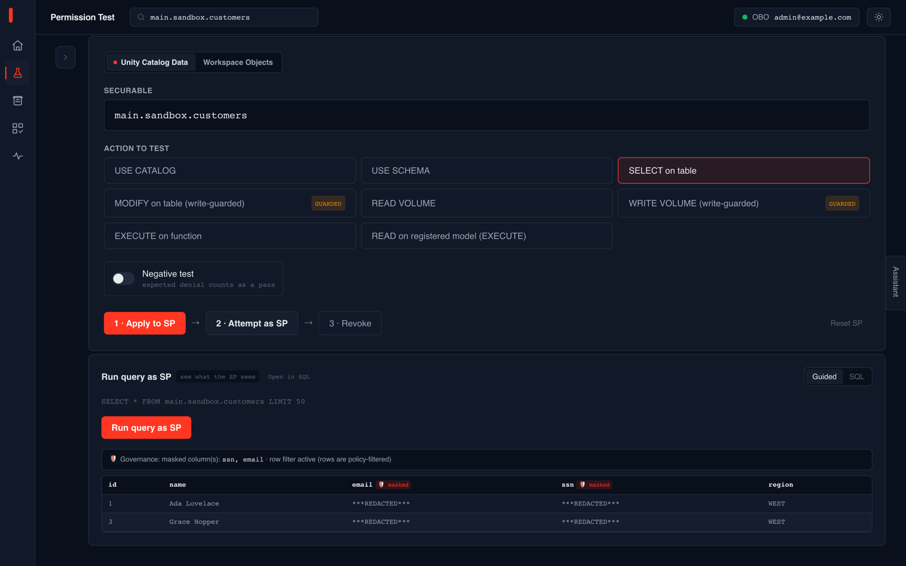

# Databricks Permission Test Harness

Test a Unity Catalog or workspace permission **before** you grant it to a person.

The usual way to check "will this grant let my teammate do X" is to change the permission and ask the teammate to try. This app closes that loop inside Databricks. An admin applies the candidate permission to the **app's own service principal**, the service principal attempts the action, and the app reports pass or fail with the real Databricks error. When the result is what you want, the app gives you the exact `GRANT` statement and a link to Unity Catalog, and you make the real grant there. The app never grants anything to a real user or group. You can also check any SQL statement as the service principal without running it.



## What this deploys

- A **Databricks App** (React UI + FastAPI backend) and the service principal Databricks creates for it.
- A **Lakebase Postgres project** for the activity log and saved scenarios. The app creates its own tables on first start.
- Optionally, a **Unity AI Gateway model service** for the built-in assistant. Everything else works without it.
- It uses a **serverless SQL warehouse** you already have.

## Screenshots

Checking an UPDATE as the service principal without running it, and what the service principal sees when it queries a masked, row-filtered table:




More in [docs/screenshots/](docs/screenshots/): a single permission test and the activity log. Names in the screenshots are anonymized.

## Prerequisites

- A Unity Catalog workspace to deploy into (a dev or test workspace, not production).
- **User authorization for Databricks Apps** turned on by a workspace admin (Public Preview).
- Lakebase Autoscaling in your region, and a serverless SQL warehouse.
- Testers who hold grant authority (owner or `MANAGE`) on the objects they want to test.
- For the optional assistant: Unity AI Gateway and access to a `system.ai` Claude model.

[DEPLOY.md](DEPLOY.md) has the full checklist, including who does each step.

## Deploy

**With Genie Code in your workspace.** Add this repository as a Git folder, open Genie Code in it, and say: *"Read DEPLOY.md and deploy the Permission Test Harness."* Genie Code asks for your settings, checks your workspace, shows you the plan, and waits for your approval before it creates anything.

**From a laptop or CI** (Databricks CLI 1.0 or later):

```bash
python scripts/provision.py preflight --profile <profile>    # checks your workspace, changes nothing
python scripts/provision.py provision --profile <profile>    # Lakebase project and model service
python scripts/provision.py bundle-vars --profile <profile>  # prints the two commands below, filled in
databricks bundle deploy --target dev --profile <profile> --var=...
databricks bundle run permission-test-harness --target dev --profile <profile>
```

Fill in [accelerator.yaml](accelerator.yaml) first. To remove everything later, run `./teardown.sh <profile>`.

## What this prototype does not do

- **A pass for the service principal is strong evidence, not proof, for a person.** People also get access through group membership, object ownership, and workspace entitlements that the app's service principal does not have. Test the exact grant you plan to make, to the level you plan to make it.
- **Test grants stay on the service principal until revoked.** Single tests have a Revoke button and *Reset SP*; scenario runs revoke automatically. Check the Activity tab after a session.
- **The SQL check never runs a statement that changes data**, so for writes it reports what Unity Catalog's planning and effective permissions say. It doesn't evaluate row filters, column masks, or ABAC policies that only apply when a write runs, and statements that depend on ownership (DROP, ALTER, OPTIMIZE, and similar) are reported as not checkable.
- **The reach sweep checks reads only.** A clean sweep means the service principal could not read the neighboring objects it tried, not that it is harmless.
- **The assistant can apply and revoke test grants on the service principal** without a confirmation step. It cannot grant to anyone else.
- **One workspace at a time.** There are no account-level or cross-workspace tests.
- **It is a prototype**, provided as-is without support or an SLA, and it depends on a Public Preview feature.

Before relying on it in production you would want a named owner, deployment through your own CI/CD, a confirmation step for assistant actions, and an alert for grants left on the service principal.

## Security

Every grant the app writes goes to its own service principal and is signed with the logged-in admin's token, so it appears in Databricks audit logs under that admin. Securable names are validated and quoted before they reach SQL, the query runner only accepts read-only statements, and each request is checked against an optional allowed group. See [docs/DESIGN.md](docs/DESIGN.md) for the trust model and [SECURITY.md](SECURITY.md) to report a vulnerability.

## More

[DEPLOY.md](DEPLOY.md) (deployment), [CONTRIBUTING.md](CONTRIBUTING.md) (local development and checks), [docs/DECISIONS.md](docs/DECISIONS.md) (why it is built this way), [docs/TROUBLESHOOTING.md](docs/TROUBLESHOOTING.md).

## License

Copyright (2026) Databricks, Inc. Provided under the [Databricks License](LICENSE). Third-party components are listed in [THIRD_PARTY_NOTICES.md](THIRD_PARTY_NOTICES.md). This is not an official Databricks product.
